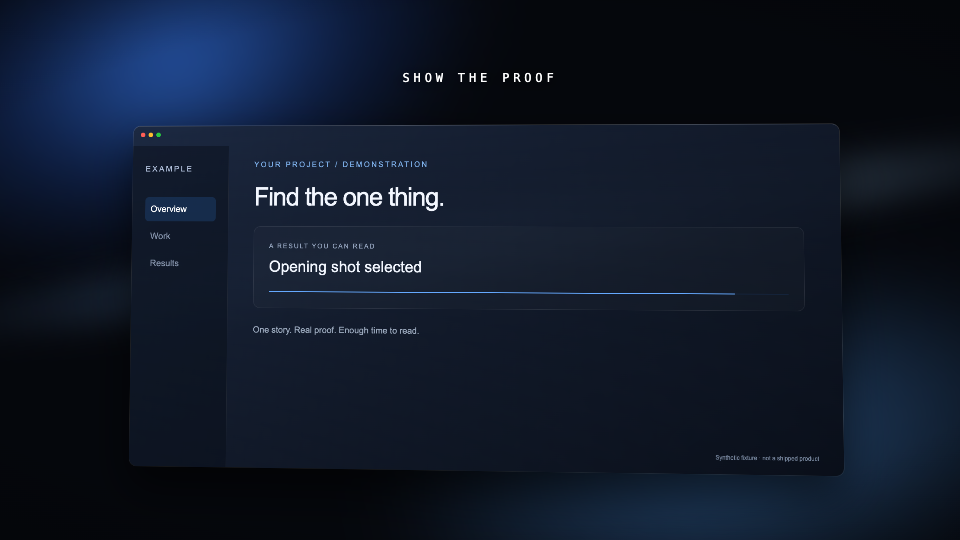
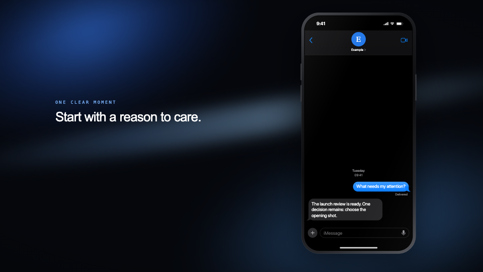

# Not Shit Video

An installable skill pack for agents making product films, launch teasers and 3D motion. The missing part is usually not another animation library. It is knowing what to show, how long to hold it, and when to stop moving things.

This collects the craft rules, reusable scene components, deterministic capture tools and production lessons from an actual film-making workflow. It includes the failed directions too.



*Rendered from the included template. Fictional UI, not a screenshot of a shipped product.*



## Give this repo to your agent

> Read INSTALL.md in this repository. Install Not Shit Video for the agent and project I'm using, including its local rendering dependencies. Then use its workflow for my next video. Do not access personal browser data, call paid services, or publish anything without my approval.

The agent needs the repository link or a local checkout. It should clone the repo and follow [INSTALL.md](INSTALL.md); there is no remote shell script to pipe blindly into a terminal.

Manual installation from a checkout:

```sh
python3 install.py --agent claude --project /path/to/your/project --setup
```

Use `--agent codex`, `pi`, `cursor`, or `generic` instead. Omit `--setup` for the instructions/components only. `--global` installs for your OS user. Existing differing installs are refused; `--update` keeps a backup outside skill discovery before replacing this pack. Agent configuration and credentials are never edited.

Start a fresh agent session afterward (Pi: `/reload`). Ask it to use **not-shit-video**.

## What's inside

- Story, marketing intent, truth checks, synthetic personas and readable pacing.
- The complete 28-principle film grammar, with historical notes on eight software launch films.
- A deterministic, network-blocked local capture tool. No personal profile, login cookies or screen takeover.
- Remotion phone scenes, messages, voice-note waveforms, receipts, glass desktop framing and typed chapters.
- A preserved seeded 3D graph fly-through, plus **13 complete Three.js reference modules**: fundamentals, geometry, materials, textures, lighting, animation, shaders, loaders, interaction, postprocessing, performance, React Three Fiber and asset optimisation (including WebGPU/TSL guidance where applicable).
- Reading-time and image-sequence retiming helpers.
- Original UI-sound synthesis, music extension at matching joints, opt-in voice generation, loudness finishing, contact sheets and a frame-glitch detector.
- The practical failures: unreadable fast text, dual captions, stale assets, frozen browser clocks, uneven capture, compositor glitches, bad pronunciation and an attractive-but-rejected graph-film direction.

Everything the installer copies lives in [`skills/not-shit-video/`](skills/not-shit-video/). Start with its [SKILL.md](skills/not-shit-video/SKILL.md). [Coverage and provenance](COVERAGE.md) explains what was preserved, adapted, replaced and deliberately excluded.

## Run the example

Requirements: **Node.js 20+, Python 3.12+, FFmpeg and ffprobe**. Runtime setup also downloads an isolated Chromium, NumPy and Pillow. Linux may need Chromium system libraries; the installer does not use sudo or alter system packages.

From an installed skill directory, or `skills/not-shit-video/` in this checkout:

```sh
npm ci --ignore-scripts
npx playwright install chromium
npm run check
npm test
npm run still
npm run demo
```

`out/demo.mp4` is a 30-second synthetic example at 4K/60 fps. It is deliberately silent until you add your own authorised sound. It is not footage of a real product or the original private film. For a smaller review render:

```sh
node tools/render.mjs Film out/review.mp4 --scale=0.5
```

For a quick repeatability/capture/encode check: `npm run smoke`. Installer checks: `python3 -m unittest discover -s tests -v` from the repository root.

## Boundaries

The pack installs local instructions and tools. It does not install an AI model, guarantee taste, recreate a private product, or give an agent permission to spend or publish. Real application capture still needs a fixture adapter for that application's actual renderer. Paid voice/music calls are optional and require your own account and approval.

No private footage, personal identities, account credentials, proprietary font files or copyrighted reference-film clips are included. Public repository ownership is still visible on GitHub; removing personal data from files does not make an account anonymous.

## Built on / rights

[Remotion](https://github.com/remotion-dev/remotion), [Playwright](https://github.com/microsoft/playwright), [FFmpeg](https://ffmpeg.org), [NumPy](https://numpy.org) and the MIT-licensed [CloudAI-X Three.js skills](https://github.com/CloudAI-X/threejs-skills). Their upstream authors are credited, not affiliated with this pack.

Remotion has its own eligibility-based licence, **not an unrestricted MIT licence**. Check [its current terms](https://github.com/remotion-dev/remotion/blob/main/LICENSE.md), particularly for company use. No project-wide licence has been selected for this repository's original material; public visibility alone is not an open-source licence. Vendored material retains its own licence. See [THIRD_PARTY_NOTICES.md](THIRD_PARTY_NOTICES.md).
